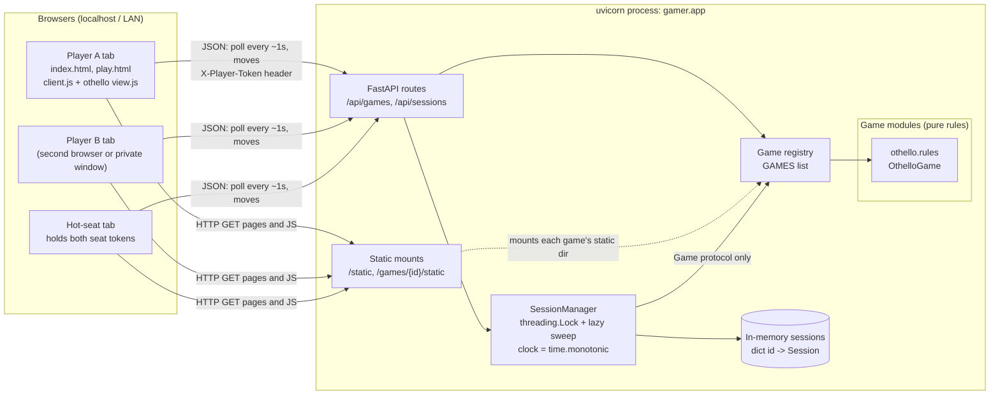

# Architecture

Companion to `design.md`. One Python process serves both the static HTML client
and the JSON API. All session state lives in memory inside that process.

## Key properties

| Concern | How it is handled |
| --- | --- |
| Real-time updates | Short polling every ~1 s with `since=<version>`. There is no server push. |
| Source of truth | `SessionManager` validates the token, the turn, and legality (via the game) before applying a move. |
| Isolation of slow clients (R1) | Every request is short and independent. The lock is held only for the in-memory update. |
| Pluggability (R2, R3) | The core sees games only through the `Game` protocol. The registry is the only place a game is named. |
| Disconnects | Each poll acts as a heartbeat. A seat with no poll for more than 10 s shows as disconnected. The seat is held while the process runs. |
| Cleanup | A lazy sweep runs at the start of each API request. There are no background tasks. |
| Persistence | None. Restarting the process clears all sessions. |
