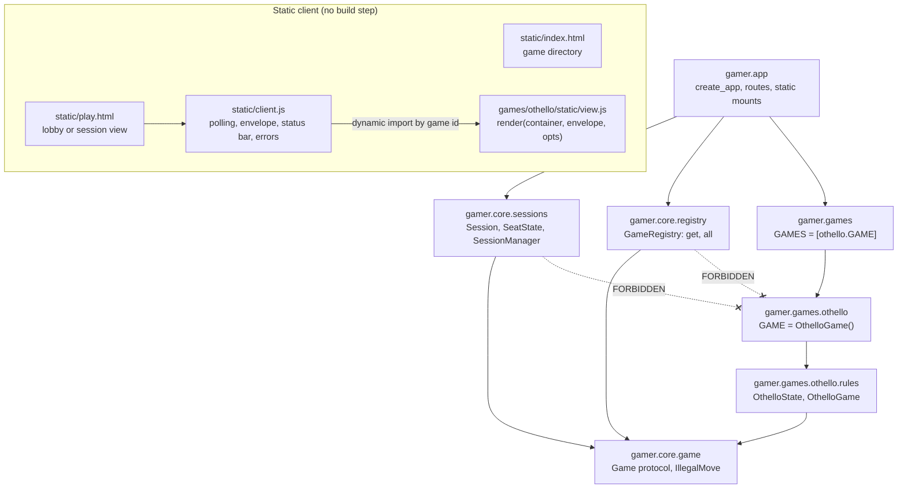
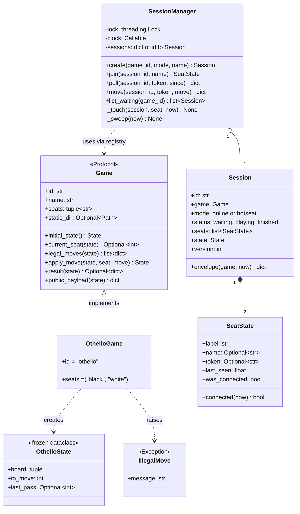

# Modules

Companion to `design.md`. Paths are relative to `exercises/python/gamer/`.

## Module dependencies

Arrows point from importer to imported. The core never imports a concrete game.

Adding a game means creating a `gamer.games.<new>` package and adding one line
to `gamer.games`. Nothing under `gamer.core` or `gamer.app` changes.

## Core types

