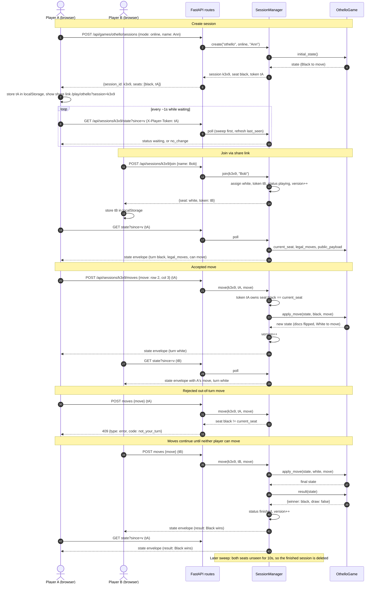

# Sequence: Main Flow (Online Othello Game)

Companion to `design.md`. Player A creates an Online session and shares the
link. Player B joins, both players poll, A moves, B sees the move, an
out-of-turn move is rejected, and the game ends.

## Variations (not drawn)

- **Illegal move**: same path as the rejected out-of-turn move, but the error
  comes from `G.apply_move` raising `IllegalMove`. The response is 422 with
  `code: illegal_move`.
- **Pass**: inside `apply_move`, if the next seat has no legal move but the
  other seat does, `to_move` stays the same and `last_pass` is set. The
  client shows "White passed".
- **Hot-seat**: step 1 sends `mode: hotseat`. The response contains both
  tokens, there is no join step, and the one tab sends whichever token
  matches `turn`.
- **Disconnect and reclaim**: when B stops polling for more than 10 s, the
  next sweep sets B to disconnected and bumps the version, so A's next poll
  shows it. B reopens the link and polls with the stored `tB`, which
  reclaims the seat.
